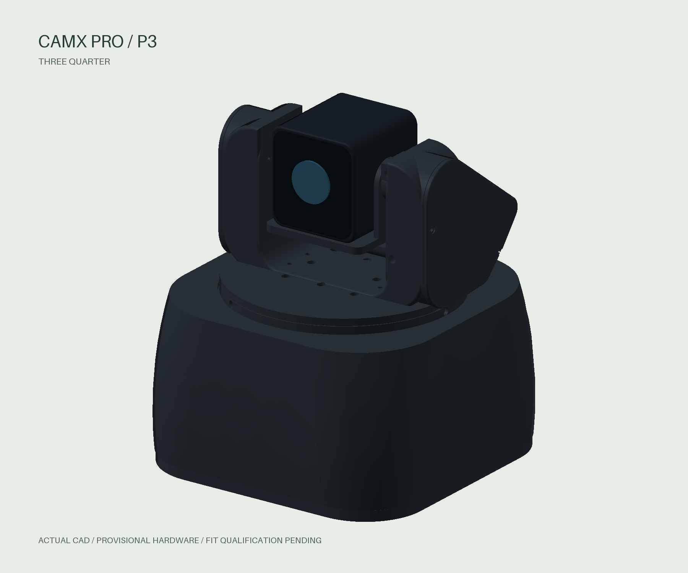

# CAMX Pro

A printable pan–tilt camera for an intact **Anker PowerConf C200**, two 28BYJ-48
steppers, ULN2003 drivers and an ESP32. The P3 design combines a U-shaped camera
frame, a **4:1 planetary pan actuator** and a **2:1 concealed tilt belt**.

[Project page](https://worxbend.github.io/camx-pro/) · [3D CAD viewer](https://worxbend.github.io/camx-pro/viewer.html) · [Remote demo](https://worxbend.github.io/camx-pro/control/?demo=1)



**Engineering fit prototype.** Physical fits, loaded torque, cable behavior and
PLA heat/creep remain qualification gates. Read the
[P3 verification record](hardware/docs/p3-verification.md) before printing.

## Repository structure

```text
apps/                    User-facing applications
  site/                  Project website and Three.js CAD viewer
  remote/                Solid.js 2 web controller
  tui/                   Scala/Glyphora terminal controller
packages/                Shared JavaScript libraries, each with src/ and test/
  control/               API session ordering, HTTP transport and demo
  bridge/                Localhost host and ESP32 proxy
firmware/                PlatformIO project: src/, include/, tests/, tools/, docs/
hardware/                Mechanical project: cad/, tests/, tools/, docs/, references/
contracts/               Shared, firmware-generated compatibility fixtures
tests/integration/       Browser scenarios and C++-backed HTTP fixture
tools/                   Repository-wide automation (see below)
  contracts/             CAD → firmware contract generation/checking
  website/               Verified CAD asset staging and Pages composition
docs/                    Monorepo architecture, operator guide and publishing
```

Each project owns its code, tests, configuration and generated output. Root files
provide shared npm workspaces, formatting, CI and Make targets. See the
[architecture guide](docs/architecture.md) for dependency boundaries and placement
rules. `AGENTS.md` is preserved unchanged.

## Web remote and website

Requires Node 24. Install JavaScript dependencies once at the root:

```sh
npm ci
npm run build:remote
CAMX_DEVICE_URL=http://DEVICE_IP npm run bridge
# Open http://127.0.0.1:4175/control/ and enter the ESP32 API token.
```

The hosted remote is an offline demo. Live control uses the local bridge or TUI;
connection never automatically references or arms the mechanism. Solid 2 is
pinned to RC.16. See the [controller guide](docs/controllers.md).

To build the website with the verified P3 model, install Python 3.11+ for asset
verification (the CAD kernel is not required):

```sh
make website
npm run test:model
node apps/site/scripts/verify-site.mjs
npx playwright install chromium
make test-web
```

The publishable artifact is `apps/site/dist/`. Development servers:
`npm run dev:site` and `npm run dev:remote` (remote starts in demo mode).

## Terminal, firmware and CAD

```sh
# Glyphora 0.20.0 / Scala 3.9.0; requires JDK 25
cd apps/tui
./mill app.run --demo
./mill app.run --url http://DEVICE_IP
```

From the repository root, `make help` lists the common targets:

| Target | Purpose |
| --- | --- |
| `make setup-hardware` | Create the pinned CAD environment with uv |
| `make test-hardware` / `make export-hardware` | Test mechanics / export printable geometry |
| `make test-firmware` / `make build-firmware` | Native C++ tests / public ESP32 build |
| `make test-tui` / `make build-tui` | Glyphora tests / runnable JAR |
| `make test-web` | Node tests and browser integration (after website build) |
| `make check` | Formatting, CAD/firmware contract and website asset checks |

Detailed instructions: [mechanical project](hardware/README.md),
[ESP32 firmware](firmware/README.md), [terminal controller](apps/tui/README.md),
[API](firmware/docs/api.md), [application verification](docs/controllers-verification.md)
and [Pages publishing](docs/pages.md).

Generated CAD files live in `hardware/exports/`; app builds live in their own
`dist/` or `out/`; PlatformIO output stays in `firmware/.pio/`. They are ignored,
along with environments and credentials. Public CAD downloads are versioned
release assets pinned by hash. The P3 manufacturing ZIP remains a historical
snapshot; use this repository for the current folder layout and applications.
